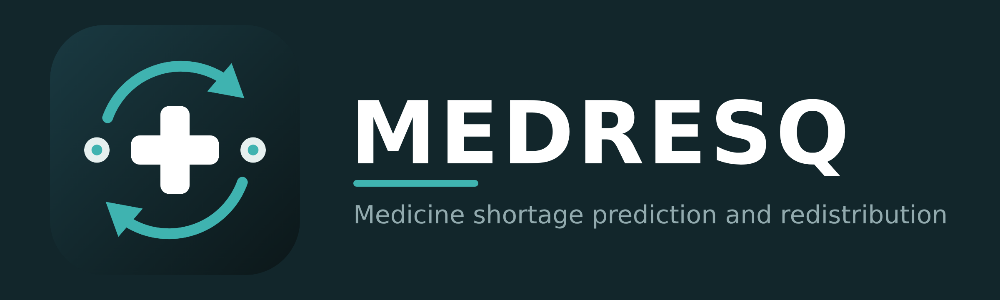
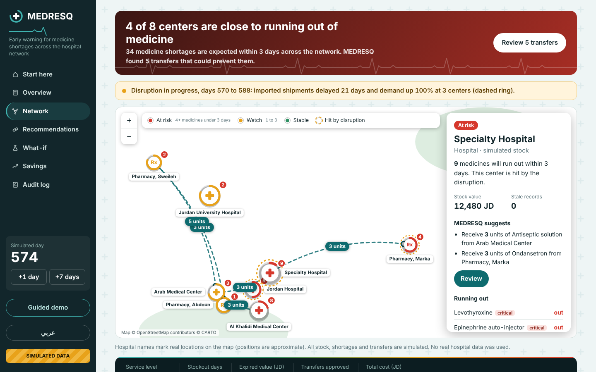
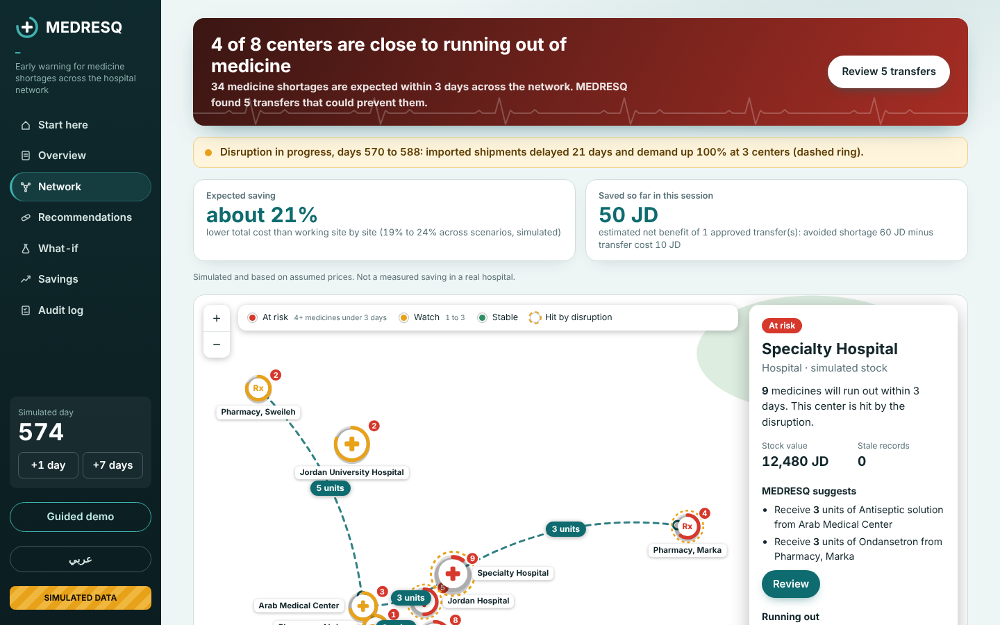
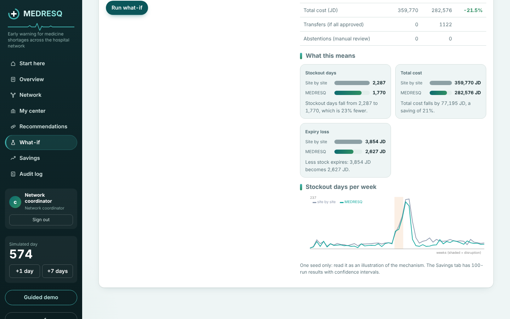

<p align="center"></p>

# MEDRESQ

**Medicine is not missing. It is in the wrong pharmacy.**
MEDRESQ is a decision-support agent that predicts medicine shortages across a network of pharmacies and hospitals, proposes the cheapest transfers between them, and leaves the final decision to the pharmacists.

Entered in the QRCE student competition, Global Entrepreneurship Week 2026 (Jordan).

> **Status: software prototype. All data are synthetic and every number is simulated.**
> No real pharmacy or hospital data, no real customers, no registered IP, and no regulatory clearance yet.

## What it does

1. **Predict.** Per-medicine demand forecast that reacts to demand surges.
2. **Suggest.** A minimum-cost transfer plan across sites. The donor keeps 21 days of stock and the received batch needs at least 30 days of shelf life.
3. **Approve.** Both pharmacists confirm. Every step is written to an audit log. Controlled drugs are excluded by design.

## Simulation results (synthetic data)

8 sites, 30 medicines, 2 simulated years, 100 runs per scenario, compared with each site deciding alone:

| Measure | MEDRESQ vs site by site |
|---|---|
| Total operating cost | 19% to 24% lower |
| Stockout days | 15% to 21% fewer |
| Expiry loss (value) | 48% to 59% lower |

These depend on assumed prices, shortage penalties and transfer costs (all in `prototype/config.py`). They show how the policies compare, not what a real pharmacy would save. Details, ablation and sensitivity analysis: [`prototype/RESULTS.md`](prototype/RESULTS.md).

## Run the demo

Needs Python 3.10+.

```bash
cd prototype
pip install -r requirements.txt
python3 launch.py            # opens the app in your browser
python3 -m unittest discover -s tests -v
```

On Windows or Mac you can also double-click `START_Windows.bat` or `START_Mac_Linux.command`.
The first run creates `accounts.json` and `PASSWORDS.txt` locally (both are git-ignored). Use `python3 launch.py --easy` for a shared demo password.
See [`prototype/README.md`](prototype/README.md) for the full file guide and [`prototype/SECURITY.md`](prototype/SECURITY.md) for what is and is not protected.

## Screenshots

| Network | Savings | What-if |
|---|---|---|
|  |  |  |

More in [`docs/screenshots/`](docs/screenshots/), including the Arabic interface and the mobile view. Site names in the demo are placeholders for a simulated network.

## Repository map

| Path | Contents |
|---|---|
| `prototype/` | Simulator, policies, forecast, demo web app (Flask), tests, results |
| `docs/research/` | Research report, version 4 (sources are labelled VERIFIED, ASSUMPTION, HYPOTHESIS and so on) |
| `docs/business/` | Cost sheet: one-time, monthly and per-center costs, price, break-even, market and impact |
| `docs/pitch/` | The 4-minute pitch: slide text and Arabic speaking script |
| `docs/screenshots/` | Interface screenshots |
| `assets/` | Logo |

## Honest limits

- Prices (JD 25 per pharmacy, JD 100 per hospital, per month) are hypotheses not yet tested with pharmacists. Costs are estimates.
- The simulated fee is about 1.27 times the expiry saving alone; the case rests on fewer stockouts, which depend on assumed penalties.
- Transfers between separately owned sites are not confirmed as allowed. A written question to the JFDA is planned.
- Environmental impact is measured in packs only; kilograms and emissions are not measured, and transfers add road travel.

## Team

Built by Rakan Qasem, with Noor Shuquara (idea, data collection) and Omar Momani (hardware prototype). See [AUTHORS.md](AUTHORS.md). Licence: [LICENSE](LICENSE) (all rights reserved).

---

<p align="center">
<sub>Prototype, simulation and AI model by <b>Rakan Qasem</b> · Data Science and AI, HTU · Robotics instructor, NIRT<br>
<a href="https://github.com/rakanqasem07-ctrl">github.com/rakanqasem07-ctrl</a> · © 2026 Rakan Qasem</sub>
</p>
